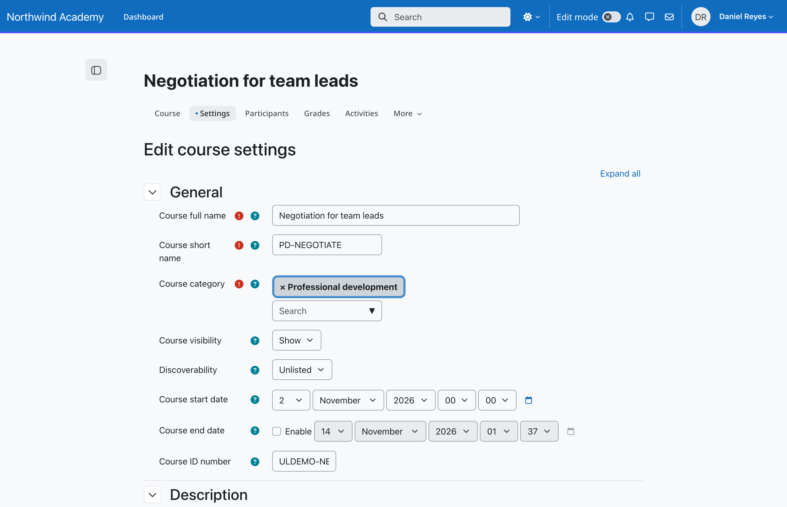
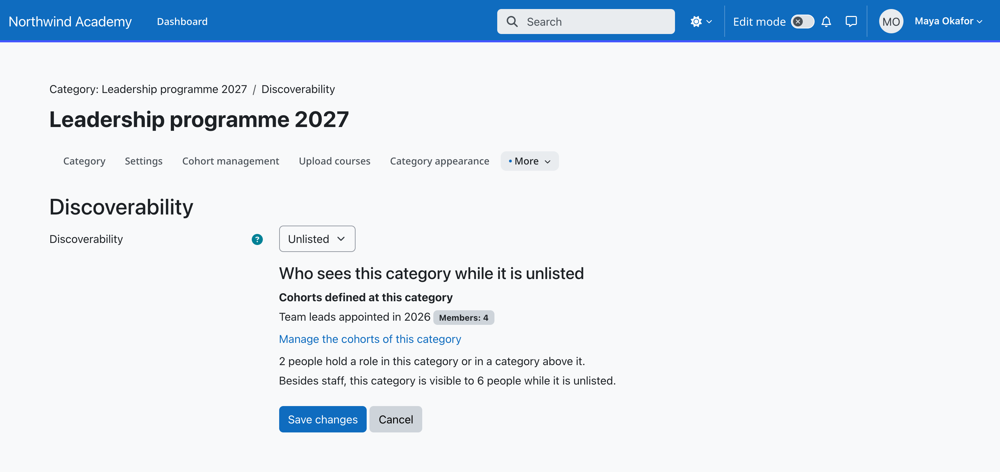
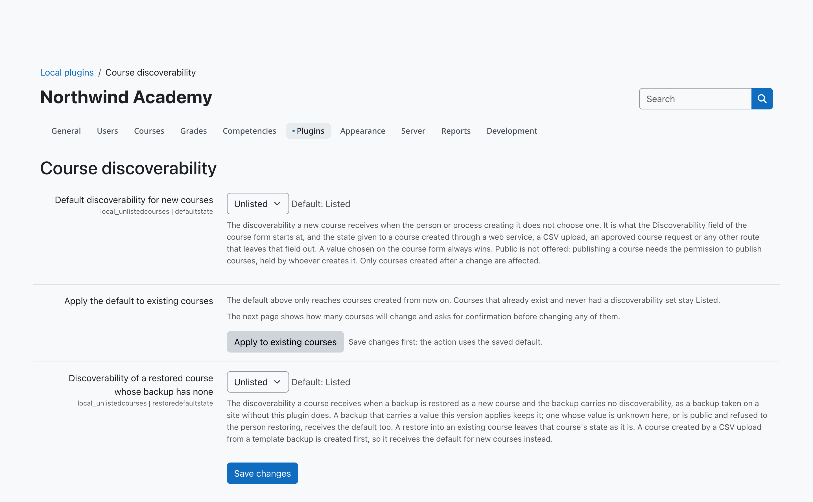
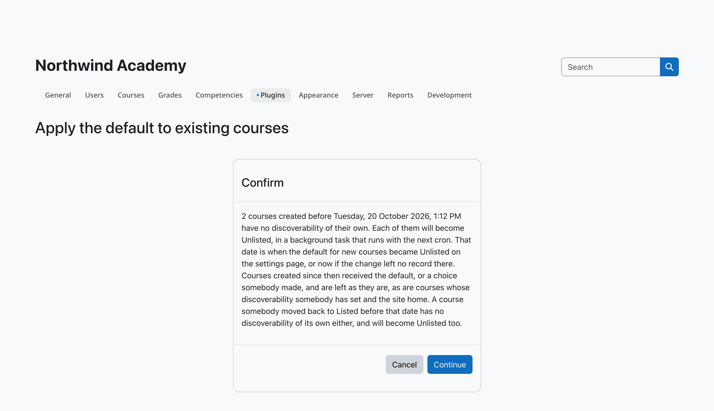
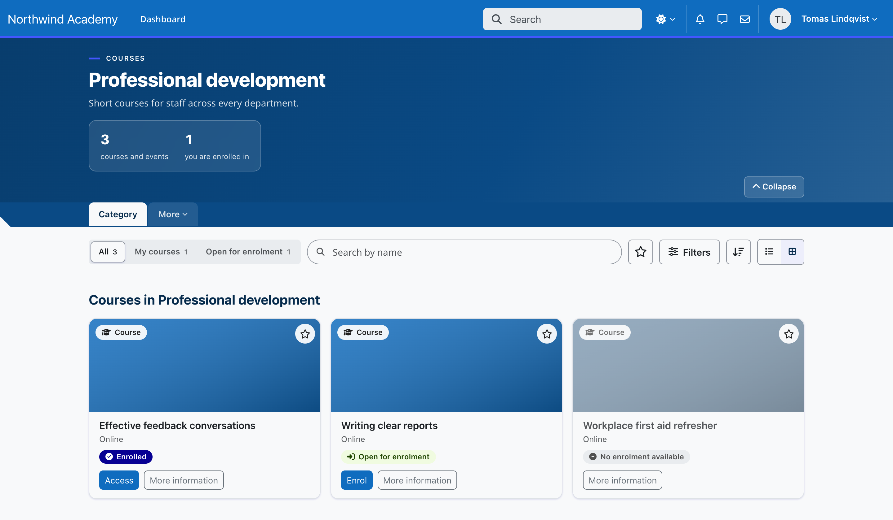
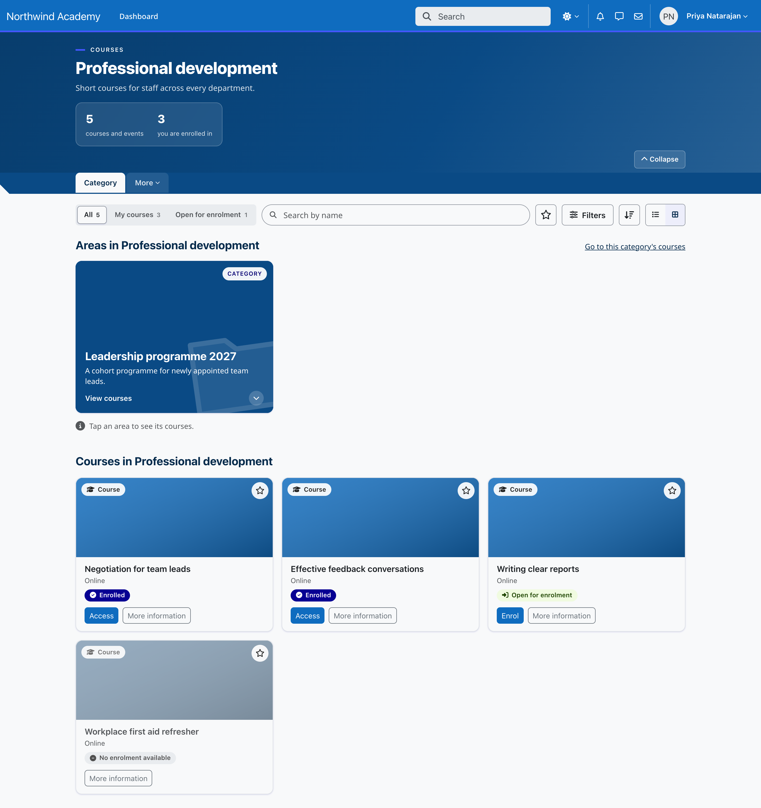
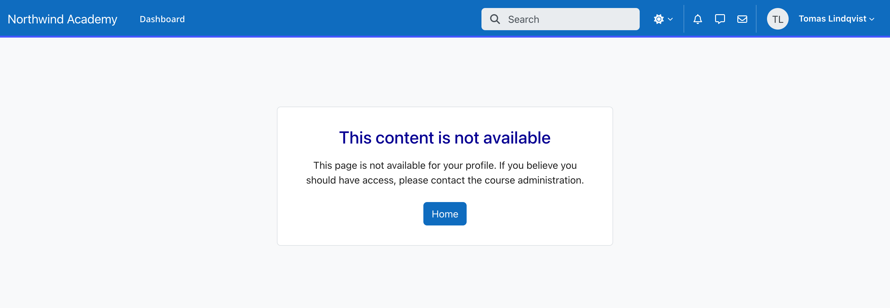

# Course discoverability (local_unlistedcourses)

[](https://github.com/uaiblaine/moodle-local_unlistedcourses/actions/workflows/ci.yml?query=branch%3Amain)
[](https://mdlshield.com/reviews/publisher/uaiblaine/local_unlistedcourses)

Owns one decision per course: **who may learn that this course exists.** Three states,
stored in the plugin's own table (`local_unlistedcourses_state`, see [Data stored](#data-stored))
and edited from the course settings form:

| State | Meaning |
|---|---|
| **Listed** (default, no row) | A course like any other. |
| **Unlisted** | Named only to people who are enrolled (also from a later date), have an application awaiting a decision, could enrol right now, will be enrolled once they complete another course, or are staff. The course stays `visible = 1` and keeps working through a direct link; it simply stops being named to anyone who is not entitled to it. |
| **Public** | In addition to being listed, the course's landing page may be served to visitors who are **not logged in**, on a site that keeps `forcelogin = 1` - so a link pasted into a messaging app shows a preview. |

The component name is narrower than its scope. It was born as "unlisted courses" and now
owns "public" too; renaming a Moodle component means uninstall, reinstall and losing the
data, so the name stays and the user-facing strings talk about discoverability.

## Screenshots

*Moodle 5.3 with the Dimensions theme and demo data: a "Professional development" category
with four courses (two listed, one public, one unlisted) and an unlisted "Leadership programme
2027" subcategory whose cohort is defined at that category. The site's default for new and
restored courses is Unlisted.*



The Discoverability field sits in the course form's General section, for whoever may change
the course's visibility; Public is offered only to someone allowed to publish.



A category's state is set on a page of its own in the category's navigation, with a preview of
who still sees the category while it is unlisted.



The two defaults, and the link to apply the default to the courses that predate it.



Applying the default counts the courses it would reach and asks before it queues anything.

<table>
<tr>
<td valign="top" width="50%"></td>
<td valign="top" width="50%"></td>
</tr>
</table>

The same category page for two learners: the unlisted course and the unlisted subcategory are
named only to the one who is enrolled in the course and belongs to the programme's cohort.



With the Dimensions theme, a learner who may not discover the unlisted course and opens its
address gets the same "not available" page as a course that does not exist; without the theme,
the course's own rules apply.

## The API

`\local_unlistedcourses\discoverability`:

- `get_states(array $courseids)`, `get_state(int)`, `is_unlisted(int)` - the stored state,
  one query per request for any number of courses.
- `state_sql(string $coursealias, string $alias = 'lus')` - the `LEFT JOIN` and the
  `COALESCE`d column that read each course's state inside a statement of the caller's own over
  `{course}`: the way to read the state of a whole population, which `get_states()`, one `IN`
  list, is not.
- `is_public(int)` / `are_public(array)` - the gate for an anonymous page. It also requires the course to be
  visible and **every category on its path** to be visible, because core's own visibility
  answer ends in a capability check that fails for user id 0 under `forcelogin`. It is a
  property of the course, not of the viewer. `are_public()` is the batched form, four
  statements for any number of courses plus the request's memoised read of the unlisted
  categories, and `is_public()` delegates to it so the two can
  never disagree; a course that is not there answers `false` and throws nothing.
- `set_state(int $courseid, int $state, ?int $userid = null)` - **the one place the
  publish capability is checked.** Entering or leaving the public state requires
  `local/unlistedcourses:publish` (manager only, no `clonepermissionsfrom`). A call that
  changes nothing needs no capability. Every change fires
  `\local_unlistedcourses\event\course_state_updated`.

`\local_unlistedcourses\access` answers the per-viewer question for unlisted courses:
`is_course_discoverable(int)`, `are_courses_discoverable(array)`, `filter_courses(array)`.
It also carries two methods for listings:
`filter_courses_public(array)`, the **only** predicate a page served to visitors who are not
logged in may use - it keeps a course when `discoverability::are_public()` says so and consults
no viewer at all - and
`prime_relationships(array $enrolled, array $pending = [], array $scheduled = [])`, which fills
the request-scoped relationship memo for the current viewer from an enrolment map the caller has
already read, so `filter_courses()` stops probing the enrolment tables one course at a time. The primer
writes **only** true: the caller vouches for a relationship it read, and is not
authoritative about the absence of one, because being staff of a course is a relationship
too. It is keyed by the viewer and dropped by `reset_caches()`.

Two more answers about the current user and a course, for the theme and blocks that print them:

- `classify_enrolment(\stdClass $row, int $now)` and `get_enrolment_state(int $courseid)`: the
  relationship the user's enrolment rows give them, with the row's dates - `enrolled`,
  `scheduled` (an active row whose start date is ahead), `pending` (an `enrol_apply` application
  awaiting a decision), `waitlisted` (on that plugin's waiting list), `suspended`, `expired` (an end
  date that has passed) or `none` (no row, a row on a disabled instance, or one that ends before it
  starts). When several rows exist the best wins, in that order.
- `get_next_action(int $courseid)`: what they may do now to join, whatever the relationship -
  `open` with its routes (`self`, `apply`, `fee`, `paypal`, `autoenrol`), `guest` (`free`, or
  behind a `key`), `conditional` (an `enrol_coursecompleted` instance, for a viewer enrolled in its
  prerequisite), `blocked` with the most useful reason (`window`, `full`, `cohort`, `own_row`,
  `off`), or `none`. Every value is a public constant of `access`. It asks each method its own
  question, with statements per instance. `get_next_actions(array $courseids)` answers a page of
  courses in at most four statements, whatever the page holds: it drops the two checks SQL cannot
  read (the self enrolment capability and `enrol_autoenrol`'s rule), so it may answer open where
  the per-course form answers blocked, never the reverse, and it never decides discoverability.
  Both answer `opens` when the course is `blocked` only because a route's enrolment window has not
  opened yet: the earliest such start date, a timestamp, or null. A surface that says when
  enrolment opens prints this date and never works one out; the batch may leave it null where
  the per-course form dates it, never the reverse.

Somebody may discover an unlisted course when any of these holds:

- they are actively enrolled, or enrolled on an enabled instance from a start date still ahead;
- they have an application awaiting a decision or on its waiting list - an `enrol_apply` row that
  is not active and whose end date is unset or still ahead, which is `enrol_apply`'s own queue
  rule (without this term, applying would make the course vanish the moment you applied);
- they could enrol right now (their next action is open or guest), each method asked what its own
  enrolment page asks:
  `enrol_self::can_self_enrol()`; for an `enrol_apply` build that provides `allow_apply()`, that
  method plus the applicant cap that lives outside it, on an instance where they hold no row yet; for
  `enrol_fee` and `enrol_paypal`, the enrolment window open, a price, and no row of theirs on the
  instance; any enabled guest instance, with or without a key; and `enrol_autoenrol`'s own
  `enrol_allowed()`;
- they will be enrolled by `enrol_coursecompleted` once they complete another course (their next
  action is conditional): an instance inside its enrolment window on which they hold no row, for a
  viewer actively enrolled in the prerequisite course the instance names;
- they are staff - `moodle/course:view` or `moodle/course:viewhiddencourses` on the course.

The relationships in that list are an explicit allow-list - enrolled, scheduled, pending,
waitlisted. A suspended or expired enrolment keeps nothing by itself, though the course stays
discoverable to that user through any route the next action still offers them.

There is no cohort setting of this plugin's own: restricting who may join an unlisted course
is the enrolment method's job, through `enrol.customint5`, the "only cohort members" field
`enrol_self` and `enrol_apply` already carry.

## Categories

`\local_unlistedcourses\category_discoverability` holds the same decision for a **course
category**, with the same three states: `get_states()`, `get_state()`, `is_unlisted()`,
`unlisted_ids()`, `public_ids()` and `set_state()` - **the one place
`local/unlistedcourses:managecategorystate` is checked**, on every real transition in both
directions, **and `local/unlistedcourses:publishcategory` on every transition that enters or
leaves the public state** (manager only, no `clonepermissionsfrom`: hiding a category from
listings is an editing act, publishing it to the open web is not). A call that changes
nothing needs no capability. Every change fires
`\local_unlistedcourses\event\category_state_updated`.

`is_public(int)` / `are_public(array)` answer whether a category may be served to a visitor
who is not logged in: its own state public, its own row visible, every category on its path
existing and visible, and no category on that path unlisted. **Ancestors need not be
public** - the same composition the course side uses - and the most-specific rule decides
what is inside: an unlisted course in a public category is never public, and neither is an
unlisted subcategory. Like the course predicate it is viewer-independent, fail-closed,
non-throwing for an id that is not there, and four statements for any number of ids.

`\local_unlistedcourses\category_access` answers the per-viewer question for categories:
`is_category_discoverable(int)`, `are_categories_discoverable(array)`,
`filter_categories(array)`. The state is a property of the **path**: a category is
effectively unlisted when it or any ancestor carries the row, and the viewer must satisfy
**every** unlisted category on that path through one of three terms:

- membership of a cohort whose context is that category's own - never an ancestor's, never
  the system one - read from `{cohort_members}` directly, so an invisible cohort still grants;
- a role assignment in that category's context or in an ancestor category context; a role at
  a category below, or at a course inside, is a relationship with something it contains;
- `moodle/category:viewhiddencategories` there, core's own idiom for staff, which is what
  admits a manager or a course creator assigned at the system context.

Site admins discover everything; visitors and guests discover nothing unlisted, without a
cohort or role query. With no category unlisted the whole predicate costs one query.

**The category term applies to listings only.** `access::filter_courses()` also drops a
course whose category is effectively unlisted unless the viewer is enrolled in it, has an
application pending or is staff of it; being able to self-enrol right now does not rescue
it. `is_course_discoverable()` keeps its meaning, because a theme gates the enrolment page,
the course info page and any landing page reached by a link on it, and a listing rule must not
become an enrolment block. `discoverability::is_public()` refuses a course with an unlisted
category on its path: an anonymous visitor can satisfy none of the three terms.

## Where the state is written

Four writers, one check. The course settings form gains a "Discoverability" select right
after "Course visibility", added from core's `after_form_definition` hook and offered to whoever
may set course visibility; the "Public" option appears only for a user who may publish, and a
course that is already public shows the control frozen **with its value still submitting**, so
saving an unrelated change never un-publishes it. The value is persisted from the
`after_form_submission` hook, which core dispatches from `create_course()` and `update_course()` -
so the web service and `tool_uploadcourse` reach the same `set_state()`, and the same capability
check. Course backup carries the state, for every course; a restore writes it through the same
`set_state()`, against the restoring user. A restorer who may not publish cannot publish through a
restore: the refusal is written to the restore log as a warning ("The course was public in the
backup, but the user restoring it may not publish courses here", or, for another state, "The
discoverability state in the backup was not applied") and the target keeps the state it had. A
restorer who holds `local/unlistedcourses:publish` keeps the backup's public state, exactly as
they could set it by hand. A restore that finds somebody else saving the target course's state
for the whole of the wait below leaves that state alone, logs a warning saying so, and restores
the rest of the course.

Every change is read, decided and written under a core lock on that course or category, so two
people saving the same one at the same moment are served one after the other, each deciding on
what the other wrote; a call that changes nothing takes no lock. A writer still waiting after
five seconds is refused with a message asking them to try again, and writes nothing.

### Defaults for new courses

Two settings, under *Site administration > Plugins > Local plugins > Course discoverability*,
decide what a course gets when nobody chose its state. Each offers listed or unlisted, and both
default to listed. Public is never a choice:
publishing needs `local/unlistedcourses:publish` of whoever creates or restores the course, and
a web service call, a CSV upload or a restore run by somebody without it would be refused.

- **Default discoverability for new courses** (`defaultstate`). The course form's select starts
  at it for a new course, and a course created without the select - by the course web service,
  `tool_uploadcourse`, an approved course request, `create_course()` from code, or a form shown
  to somebody who may not set course visibility - receives it. A value chosen on the form always
  wins, and updating a course never applies it.
- **Discoverability of a restored course whose backup has none** (`restoredefaultstate`). A
  backup taken on a site without this plugin carries no state; restored as a new course, it gets
  this one. A backup whose state is applied keeps it; a state this version does not know, or a
  public one refused because the restorer may not publish, gets the default too. A restore
  into an existing course leaves that course's state alone. A course created by a CSV
  upload from a template backup is created first, so it gets the default for new courses.

#### Applying the default to existing courses

The default reaches a course only when it is created, so the courses a site already had when the
plugin was installed, or when an administrator chose unlisted as the default, stay listed. The
settings page has an *Apply to existing courses* button, under the default, for a page
(`local/unlistedcourses/applydefault.php`, site administrators only, `moodle/site:config`), which
counts the courses the default would reach, asks for confirmation, and queues an adhoc task; the
page itself writes nothing, and the task runs with the next cron, showing its progress on the page.
The confirmation is bound to the date it names: if the default is saved again before it is
confirmed, nothing is queued and the page asks again.

A course qualifies when it has **no stored state** and was **created before the default took its
current value**. A stored state, whatever it is, is never overwritten, and the site home is never
touched. Listed is the absence of a row, so a course somebody set to listed looks like a course
nobody touched; the creation time tells them apart for every course created since the default took
effect, because each of those received the default, or a choice somebody made, when it was
created. When the default took effect is read from the configuration change log, where core
records every change made on a settings page; a value set from the command line leaves no record
there, and then every existing course counts as older than the default. A course that is older
than the default and was moved back to listed by hand cannot be told from a legacy one, and the
confirmation says so.

With a listed default there is nothing to apply. The task writes in chunks of 200 courses, one
transaction each, keeps a state somebody set while it ran, writes nothing if the default was
changed again before it ran, and fires `course_state_updated` for every course it changes, with
the administrator who queued it as the user. Running it again changes nothing.

##### Recovering an interrupted backfill

If the process running the task is killed halfway (a container replaced, an out-of-memory kill, a
node lost), the chunks already committed stay written and the task is left marked as running: its
row in `task_adhoc` keeps `timestarted` set, with the `hostname` and `pid` of the dead process, and
`faildelay` stays 0. Cron does not pick the row up again, on the same node or on a fresh one,
because it only takes rows whose `timestarted` is empty, and core has no timeout that releases it.

To finish it, find the task's id (the `id` of the row whose `classname` is
`\local_unlistedcourses\task\apply_default_state`, or the "Adhoc task id" line cron prints) and run
it by hand from the Moodle root, as the web server user:

```sh
php admin/cli/adhoc_task.php --id=<id>
```

No `--force` is needed (that option only overrides a disabled cron). The task starts over from the
beginning, skips every course that already has a state, writes the rest, and removes its own row.
Running it a second time, or letting the page queue a new task, changes nothing further.

Courses written before the interruption keep their state, but the `course_state_updated` events of
the chunk that was being logged when the process died may be missing, and the recovery run does not
fire them again, because those courses already have a row.

A category's state is written from one page, `local/unlistedcourses/category.php`, reached
from the category's settings menu (the "More" menu of a category page), where the plugin's
`local_unlistedcourses_extend_settings_navigation()` callback puts it for a holder of
`local/unlistedcourses:managecategorystate`: core dispatches no hook from the category form and
has no custom field handler for categories. The page shows
who will still see the category - the cohorts defined at it, behind `moodle/cohort:view`,
the people holding a role here or above, and how many people it stays visible to besides
staff, intersected over every unlisted category above it - and warns when that is nobody and
when category themes are enabled. There is no backup or restore of a category's state:
Moodle has no category backup a plugin could attach to.

Its form follows the course form exactly: the "Public" option is offered only to a user
holding `local/unlistedcourses:publishcategory`, and a category that is already public shows
the control frozen with its value still submitting, so saving an unrelated change never
un-publishes it and never fails over a value the editor did not touch. A save whose value the
form no longer offers - the category was changed by somebody else since the page was shown -
writes nothing and says so, rather than reading the missing value as listed. For a public category
the page replaces the cohort and role accounting with what a visitor will be served, and
warns when an unlisted or hidden category on the path makes the public state inert.

### When a course or category is deleted

A course's row is dropped by an observer of `\core\event\course_deleted`, not by the
`before_course_deleted` hook: with asynchronous course deletion core runs the hook when the
deletion is requested and the course goes on existing, hidden, until the cron deletes it, and
the state must stay with it until then. A category's row is dropped the same way, by an observer
of `\core\event\course_category_deleted`, which core fires once per category after it is gone:
a deletion core aborts half-way, such as one that meets a course with a backup pending, leaves
every category it did not delete with its state.

When a category is deleted with its contents moved, its children keep their own states, but the
deleted category's own unlisted (or public) state stops applying to what it held: the courses and
subcategories follow the new parent's path from then on, so under a listed parent they are listed.

A deletion with its contents moved publishes nothing. A course or category whose own state is
public is not served to visitors while an unlisted or hidden category is above it; when the move
takes it under a path that would serve it, nobody who may publish decided that, so the plugin
takes it back to listed (the usual state-changed event is logged, naming the user who deleted the
category). Public courses and categories that were already served before the deletion, and those
the move leaves held back, keep their state. Before the move the plugin only records which public
states are held back; it acts after core has deleted the category, so a deletion core aborts
changes no state.

Three limits. A course or category whose state is still being changed by somebody else when the
deletion finishes (the plugin waits five seconds) is skipped: it stays public, and the skip is
written to the debugging output. On the management page there is a short interval between core
moving the courses and the category being deleted during which a moved public course is already
served; the web service does the whole deletion in one transaction, so it has no such interval.
And when core fails while moving the courses, the subcategories have already moved under the new
parent, the category survives, and no state is changed.

This covers deletion with its contents moved only.

### Moving a course or a category publishes what was held back

Any other move is not observed: a course moved to another category (from its settings page or
with the management page's bulk move) and a category given another parent follow their new path
from then on. Two consequences follow, and the second one is easy to miss:

- What leaves an unlisted category is listed again, unless its own state says otherwise.
- A course or category whose own state is **public** keeps that state while an unlisted or hidden
  category above it holds it back, and it is served to visitors who are not logged in as soon as
  a move takes it to a path that serves it. The person moving it needs only
  `moodle/category:manage` (or `moodle/course:changecategory` for one course), not the capability
  to publish, and the plugin logs nothing: the state row did not change.

Before moving a course or a subcategory out of an unlisted or hidden category, check its own
discoverability and set it to listed if it should not go public. Preparing courses as public
inside an unlisted category and moving them out to publish them works for the same reason.

## What this plugin does not do

**It renders nothing.** Overriding a course renderer is a theme privilege in Moodle -
`theme_config::renderer_prefixes()` returns only `theme_<name>` prefixes, and Moodle has no
`db/renderers.php` through which a plugin could substitute one. The course and category
listings, the gating of the enrolment and course info pages, and any public landing page served
to visitors who are not logged in belong to the site's theme, which consumes these predicates.
`theme_dimensions`, a Boost Union child
theme for Moodle 5.3, is the reference implementation.

**`access` is current-user only.** `can_self_enrol()` and `allow_apply()` both read `$USER`
rather than taking a user id, so answering for an arbitrary user would mean reimplementing
both - and a reimplementation that drifts from the plugin it mirrors fails open.

**It caches nothing beyond the request.** The answer depends on cohort membership, and
`tool_dynamic_cohorts` writes `cohort_members` in bulk without firing
`cohort_member_added`/`removed`. A cache invalidated by those events would keep showing a
course to somebody just removed from the cohort that gated it.

**It does not cover every surface.** The predicate is only consulted where something calls
it. Course files served through `pluginfile.php`, badge pages, the report builder and the
web service layer each reach course names by their own route. For a category the list is
longer - the course web services (`core_course_search_courses` is `ajax => true`, so any
logged-in browser session can call it), the mobile app, the Navigation block,
`block_course_list`, Boost Union smart menus, the report builder's category entity and the
course request page all name a category by their own route - and is written down, with what to
do about each, in [the developer guide](docs/developer-guide.md#73-it-does-not-cover-every-surface).
Two more name an unlisted **course** to people with no relationship with it: core's
user profile page, whose "Course details" lists every course the user is enrolled in to anybody
core lets view that profile (hiding *My courses* through the `hiddenuserfields` setting removes it,
for listed courses too; a theme can cover the page instead), and the global search's course area,
which asks only core's visibility of the course.
Unlisting is a listing rule, not a permission.

## Consequences worth knowing

The enrolment methods enforce their windows and places limits, so an unlisted course
disappears from the listings of somebody who could otherwise join it while its enrolment window
is shut or once it is full. That is the same answer core's own enrolment icons give, but it does
make the listing time-dependent.

A public course is armed but inert until the site's theme gives it a landing page: the
plugin only says "may be served anonymously", it serves nothing itself.

## Reporting

Two data sources for Moodle's custom reports (*Site administration > Reports > Report builder >
Custom reports*) list what the two tables hold, so a manager can follow which courses and
categories are unlisted or public without opening each one:

- **Courses and their discoverability** - every course except the site home, with core's course
  and category columns and, from this plugin: the course's state (listed, unlisted, public), the
  effect of a public state, the user who last changed the state and when, and the state of the
  category the course sits in.
- **Course categories and their discoverability** - every category with the same columns for
  the category's own state.

The effect column says whether a public state is in effect (the page is served to visitors) or
held back, and by what: the course or category is hidden, a category above it is unlisted, or a
category above it is hidden. It is the answer `discoverability::is_public()` and
`category_discoverability::is_public()` give, computed in the database so a report can filter and
sort by it. A report with the condition "Effect of the public state" set to one of the held-back
values lists the public states that would start being served if the course or category were
moved or the category above it changed, which the plugin does not watch for on a plain move.

The data sources add no capability and apply none of the plugin's rules about the viewer. Like
core's own Courses data source they list every course, unlisted ones included, to whoever is in
the report's audience, and the name of the user who last changed a state follows core's user
entity. Who may create a report is core's `moodle/reportbuilder:edit`; give such a report an
audience of managers.

## For developers

[`docs/developer-guide.md`](docs/developer-guide.md) is the technical guide for theme and plugin
developers: the data model and who may write each transition, every public predicate with its
contract and query budget, the relationship and next-action vocabulary, the category semantics,
how a theme integrates the answers (listings, pages reached by a link, anonymous pages and files
on a site that forces login), worked examples from `theme_dimensions`, `block_compass` and
`local_dimensions`, and how to test an integration. The class docblocks in `classes/` remain the
source of truth.

## Settings

Under *Site administration > Plugins > Local plugins > Course discoverability*, both stored in
`config_plugins` and described in [Defaults for new courses](#defaults-for-new-courses):

- `local_unlistedcourses/defaultstate` (default: listed) - the state of a course created without
  one chosen.
- `local_unlistedcourses/restoredefaultstate` (default: listed) - the state of a course restored
  as a new course from a backup that carries none.

Each offers listed or unlisted; public is never a choice.

Below the first one, a button to the page that applies it to existing courses, described in
[Applying the default to existing courses](#applying-the-default-to-existing-courses).

## Capabilities

| Capability | Context | Default | What it allows |
|---|---|---|---|
| `local/unlistedcourses:publish` | course | manager | Making a course public, or taking it out of the public state. `RISK_SPAM` and `RISK_PERSONAL`: the published page carries author-written text to the open web and can name participants. |
| `local/unlistedcourses:managecategorystate` | category | manager | Changing a category's state at all (listed, unlisted or public). |
| `local/unlistedcourses:publishcategory` | category | manager | Making a category public, or taking it out of the public state, on top of the previous one. `RISK_SPAM`. |

None of them is cloned from a core capability, so no upgrade back-fills them. Moving a course
between listed and unlisted needs no capability of this plugin: the select is offered to whoever
may set course visibility (`moodle/course:visibility`) on a form they may already save.

## Data stored

Two tables, each holding a row only for something in a non-default state:

- `local_unlistedcourses_state` - one row per unlisted or public course: the course, its state,
  the user who last changed the state (`usermodified`) and when (`timemodified`).
- `local_unlistedcourses_catstate` - the same for an unlisted or public course category.

A row lives as long as its course or category stays unlisted or public. It is deleted when the
state returns to listed, when the course is deleted (an observer of
`\core\event\course_deleted`) or when the category is deleted, and both tables are dropped when
the plugin is uninstalled. A course backup carries the course's state and nothing about who set
it. The two settings above are site configuration. Each state change fires an event
(`course_state_updated`, `category_state_updated`), which the site's log stores keep under their
own retention and privacy rules. The plugin stores no files and no user preferences.

The report builder data sources described under [Reporting](#reporting) read both tables and
store nothing.

The only personal data is `usermodified`, and the Privacy API covers it; a row written by the task
that applies the default to existing courses records the administrator who queued it there, as any
other change does. A data request exports,
for every course and category whose state the user last changed, that state and the time of the
change. A deletion request detaches the user from the row (`usermodified` becomes 0) and leaves
the state in place: removing the row would un-hide or un-publish a course, or un-hide a category,
as a side effect of somebody leaving the site.

## Requirements

Moodle 5.3 on this branch (`main`, identical to `MOODLE_503_STABLE`). Moodle 5.2 is served by the
`MOODLE_502_STABLE` branch, release `v5.2-r5`. Moodle 4.5 and 5.1 are not supported.

## Installation

Copy the plugin to `local/unlistedcourses` in your Moodle directory (`public/local/unlistedcourses`
on Moodle 5.1 and later), or install the release zip from the Moodle plugins directory, then
visit *Site administration > Notifications* to run the installation.

## Translations

The English strings ship in the package. The Brazilian Portuguese translation is maintained in this
repository (`lang/pt_br`) and reaches sites through [AMOS](https://lang.moodle.org/), as the
plugins directory requires; it is left out of the release package.

## License

GNU GPL v3 or later, <http://www.gnu.org/copyleft/gpl.html>. Copyright 2026 Anderson Blaine.
